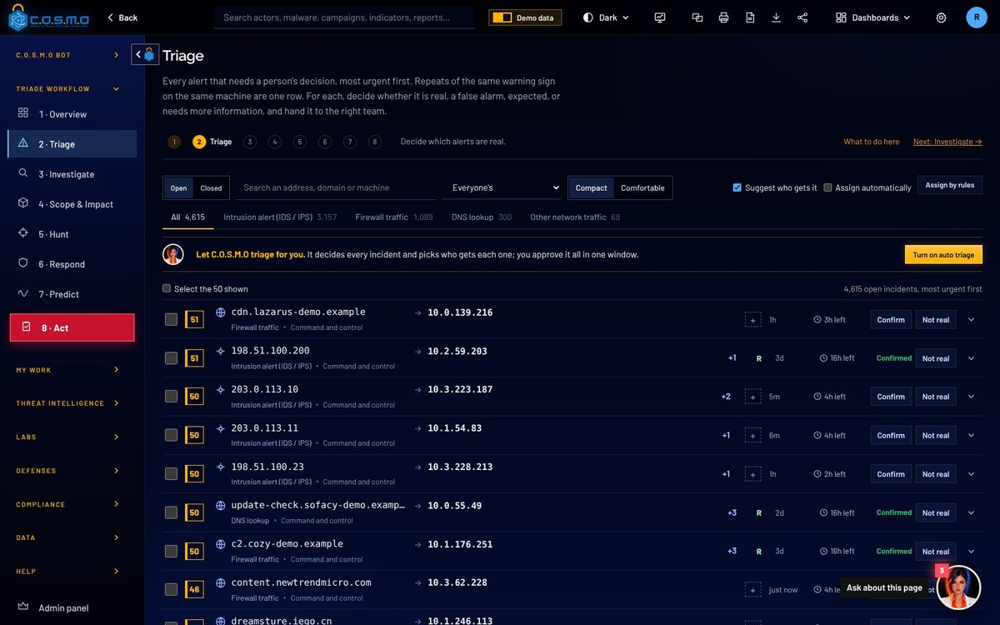

# cypher-llc.com

The Cypher, LLC website and capabilities statement. Plain static files: no build step, no frameworks, no npm. Open any `.html` file directly in a browser, or publish the folder with GitHub Pages.

## What is in this folder

| File | What it is |
| --- | --- |
| `index.html` | Home page: slider, credentials, capabilities, customers, contract vehicles, products, how to buy, leadership |
| `services.html` | Capabilities: the six service areas in detail and the adaptive services |
| `products.html` | C.O.S.M.O and G.H.O.S.T. (two separate products), with screenshots  |
| `about.html` | Who we are, our goal, leadership, certifications, partners, customers |
| `contact.html` | Contact form and direct contacts |
| `capabilities.html` | The printable two-page capabilities statement (words come from `js/capabilities-data.js`) |
| `404.html` | "Page not found" page GitHub Pages shows for a wrong address |
| `CNAME` | Tells GitHub Pages the domain is `cypher-llc.com`. Leave it as is. |
| `css/site.css` | All styles. Colors are at the top in `:root`. |
| `js/site.js` | Header, mobile menu, slider, scroll animations |
| `js/contact.js` | Sends the contact form |
| `js/capabilities-data.js` | **Every word of the capabilities statement** |
| `js/capabilities.js` | Lays out the statement (no need to edit) |
| `assets/Cypher-Capabilities-Statement.pdf` | The ready PDF of the statement |
| `assets/img/` | Logos, screenshots, favicon |
| `assets/fonts/` | Barlow font files (SIL Open Font License, see `OFL-Barlow.txt`) |
| `tools/make-pdf.mjs` | Rebuilds the PDF from `capabilities.html` |

## Editing a page

Each page is ordinary HTML. Open it in any text editor, find the sentence, change it, save, reload the page in a browser.

- **Header and footer are repeated on every page** (marked with `<!-- ===== HEADER ... -->` and `<!-- ===== FOOTER ... -->`). If you change a menu item, the phone number or the address there, make the same change in every `.html` file. A search-and-replace across the folder does it in one step.
- **The icon set** is the `<svg ...><symbol id="i-...">` block right after `<body>` on each page. Icons are used as `<svg><use href="#i-shield"/></svg>`. Names: shield, radar, code, layers, server, plane, arrow, left, right, pause, play, phone, mail, pin, download, star, calendar, id, hash, award, lockshield, crosshair, target, alert, lock, gauge, menu, external, bag, quote, building.
- **Animations**: anything with `class="reveal"`, `class="tilt-in"` or inside an element with `data-stagger` fades in when scrolled to. Numbers with `data-count="2009"` count up to that number (the real number is also written in the HTML, so it shows without JavaScript). All motion turns off for visitors who ask their system for reduced motion.
- **The home page slider**: each slide is a `<div class="slide">` inside `.slides`. Copy one to add a slide. It changes every 7 seconds (`DELAY` in `js/site.js`), pauses when the mouse or keyboard focus is on it, and has previous, next, pause and dot buttons; left and right arrow keys work too.
- **Colors**: `css/site.css`, top of the file. `--green: #218426` and `--logo-grey: #404040` are sampled from the logo in the original capabilities statement PDF.
- **Copyright year**: the footer says `© 2026`. Change it in each page's footer.

### Logo

`assets/img/cypher-logo.svg` (charcoal and green, for light backgrounds) and `assets/img/cypher-logo-white.svg` (white and green, for dark backgrounds) are vector tracings of the logo on page 1 of the original capabilities statement, with the four dots of the E redrawn as exact circles. They stay sharp at any size and in print.

### Images and screenshots

- C.O.S.M.O screenshots: `assets/img/cosmo-*.jpg` (1200 x 750, real screens of the product).
- G.H.O.S.T.: `assets/img/ghost-screen.jpg` and `ghost-logo-*.png`, taken from page 4 of the original capabilities statement. The source picture is small, so the G.H.O.S.T. screen is a little soft; replace it with a full-size screenshot when one is available (same name, any 16:10 size).
- To replace a picture, save the new file with the same name. Keep photos under about 300 KB (JPEG quality 80, about 1600 px wide is plenty).

### Device mockups (laptop and monitor frames)

Screenshots are shown inside drawn laptop and monitor frames made only with CSS. To put any screenshot in a frame, copy one of these:

```html
<figure class="device laptop">
  <div class="lid"><div class="screen"></div></div>
  <div class="base"></div>
</figure>

<figure class="device monitor">
  <div class="bezel"><div class="screen"></div></div>
  <div class="neck"></div><div class="foot"></div>
</figure>
```

Put a monitor and a laptop together inside `<div class="duo">...</div>` for the overlapping pair used on the home page. The frame takes the width of whatever contains it. Screens are 16:10; other shapes are cropped from the top left. On a light background add `light-bg` to a parent so the floor shadow is softer.

### Stock photography

No stock photos are in the site yet: the sources (Unsplash, Pexels, DVIDS, NASA and other public-domain government sites) could not be reached from the computer that built it. The design works without them (dark brand panels with the dotted pattern from the logo). When you add photos, download them (never link to another site), compress them, and record each one here with its source URL and license. Where they go:

- **Slider**: add `<div class="slide-photo" style="background-image:url(assets/img/photos/ops-center.jpg)"></div>` as the first line inside a `<div class="slide">`. A dark overlay is added automatically so the text stays readable, and the photo slowly zooms while the slide shows.
- **Capability cards and the Capabilities page panels**: in `<div class="fill"></div>`, add `class="fill photo" style="background-image:url(assets/img/photos/aviation.jpg)"`.

| Photo | Source URL | License |
| --- | --- | --- |
| (none yet) | | |

## The capabilities statement

`capabilities.html` shows the statement as two US Letter pages, with **Download PDF** and **Print** buttons. Every word on it is in **`js/capabilities-data.js`**, one well-commented object. Edit the text between the quotes, save, reload `capabilities.html`.

Rules: keep every quote, comma and bracket; write `\"` for a double quote inside text; a list is `[ "one", "two" ]`. If a page gets too full, a red warning appears above the pages saying which page; shorten text until it goes away (the PDF tool refuses to build while the warning is showing, so a cut-off PDF cannot be produced).

### Every field

| Field | Where it prints | Notes |
| --- | --- | --- |
| `documentTitle` | Top right of both pages | "Capabilities Statement" |
| `documentDate` | Under the title | Change when you update the statement |
| `leadLine` | Large sentence under the logo, page 1 | Words in `**double stars**` print green |
| `overview` | "Overview", page 1 | One string per paragraph |
| `competencies` | "Core competencies", page 1, two across | Each `{ title, text }` |
| `adaptiveServices` | "Adaptive services", page 1 | List of names |
| `differentiators` | "Why Cypher", numbered, page 1 | Each `{ lead, text }`; `lead` prints bold |
| `goal` | "Our goal" quote, bottom of page 1 | Quotation marks are added for you |
| `company.legalName` | Footer of both pages | |
| `company.uei`, `company.cage` | Company data and footers | |
| `company.founded`, `businessSize`, `socioEconomic` | Company data | |
| `company.facilityClearance` | Company data | Set to `""` to hide the row |
| `company.addressLine1`, `addressLine2`, `phone`, `website` | Company data and footers | Phone becomes a tap-to-call link |
| `naics` | "NAICS codes", page 1 | Each `{ code, title }` |
| `contacts` | "Contact", page 1 | Each `{ name, credentials, title, email, phone }` |
| `offerings` | "Offerings in detail", page 2, flows into three columns | Each `{ area, items: [...] }` |
| `primeVehicles`, `subVehicles` | "Contract vehicles", page 2 | Each `{ name, note }`; `note` prints small at the right |
| `customers` | "Customers", page 2 | List of names |
| `partners` | "Partners", page 2 | Each `{ name, note }` (text only, no logos) |
| `certifications` | "Certifications", page 2 | List |
| `products` | "Products", page 2 | Each `{ name, logo, screenshot, text, linkText, link }`; the screenshot is drawn inside a small laptop |

### Rebuild the PDF

After changing the statement, rebuild the PDF so the download matches:

```
node tools/make-pdf.mjs
```

It needs Node.js 18 or newer and Playwright, installed once with `npm install -g playwright` and `npx playwright install chromium`. It writes `assets/Cypher-Capabilities-Statement.pdf` (US Letter, backgrounds printed, exactly two pages). To use an installed Chrome instead, set `CHROME_PATH` to its path. You can also print `capabilities.html` from Chrome or Edge with "Save as PDF", margins "None" and "Background graphics" on.

## Contact form

The form on `contact.html` is sent by [the site-forms Worker (Resend)](https://formsubmit.co), a free service that emails each message on. It is the only outside service the site talks to.

**The receiving email address is set in one place: the `<form id="contact-form">` tag in `contact.html`.** It appears twice on that one tag; change both:

```html
<form class="form" id="contact-form"
      data-email="janderson@cypher-llc.com"
      action="https://formsubmit.co/janderson@cypher-llc.com" method="POST">
```

`data-email` is used when JavaScript is on (the message is sent in the background and a thank-you message replaces the form; a plain error message shows if it fails). `action` is used if JavaScript is off (a normal form post; the site-forms Worker (Resend) then returns the visitor to `contact.html?sent=1`, which shows the thank-you message).

**One-time activation:** the first time anyone sends the form, the site-forms Worker (Resend) emails the receiving address asking to confirm it. Click the link in that email once, and messages are delivered from then on. (Send a test message yourself right after publishing.) After activating, the site-forms Worker (Resend) also offers a random alias for the address; you can put that alias in place of the address in both spots to keep the address out of the page source.

Other settings are hidden fields inside the form: `_subject` (the email subject line), `_honey` (a hidden trap field that stops most spam bots), `_template` (table layout for the email) and `_next` (where no-JavaScript visitors land after sending). the site-forms Worker (Resend)'s own captcha is left on for non-JavaScript submissions.

## Publishing on GitHub Pages

1. Put the contents of this folder at the top of the repository (or in `/docs`).
2. Repository Settings, Pages: source "Deploy from a branch", choose the branch and folder.
3. Custom domain: `cypher-llc.com` (the `CNAME` file already says this). At the domain registrar, point the domain at GitHub Pages (A records `185.199.108.153`, `185.199.109.153`, `185.199.110.153`, `185.199.111.153`, and a `CNAME` record for `www` to `<your-github-user>.github.io`). Then tick "Enforce HTTPS".

## Facts and their sources

Every fact on the site comes from Cypher's capabilities statement PDF (UEI, CAGE, NAICS codes, SDVOSB, founding year, address and phone, cleared onsite staff, services, adaptive services, offerings, contract vehicles, customers, partners, certifications, the goal quote, leadership and their contact details, the G.H.O.S.T. description and screen). C.O.S.M.O facts come from the C.O.S.M.O project README (name, tagline, workflow, local STIX 2.1 knowledge base, self-hosted on Mac, Windows, Linux or Docker). The Carahsoft reseller statement (C.O.S.M.O available through Carahsoft, the Master Government Aggregator®, and its reseller partners and contract vehicles) comes from Cypher's owner. G.H.O.S.T. is a separate product with nothing in common with C.O.S.M.O; no source says it is sold through Carahsoft, so the site does not say so. Keep the two apart in any new wording. NAICS titles are the official NAICS code titles. No Carahsoft contract number or schedule is claimed.

## Placeholders to fill in

These show highlighted in yellow so they cannot be missed. Search for `[EDIT:` to find them.

| Placeholder | Where |
| --- | --- |
| CMMC level | `js/capabilities-data.js` (`differentiators`, `certifications`), `about.html` |
| Facility clearance level (or hide the row) | `js/capabilities-data.js` (`company.facilityClearance`) |
| Contract numbers for FAA eFAST and SeaPort NxG | `js/capabilities-data.js` (`primeVehicles`) |

Not on the site because no source states them (add them if you have them): social media links (LinkedIn), leadership photos and biographies, past performance write-ups with contract numbers and values, a general company email address (the site uses Joseph Anderson's address), DUNS (retired in favor of the UEI).
